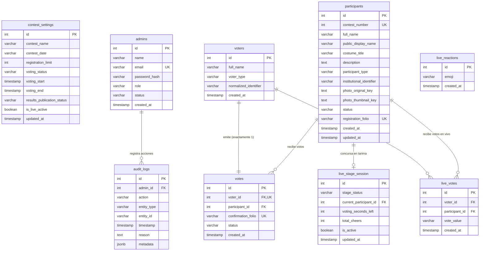

# 🎃 Concurso FMVZ — Documento 05: Diseño y Especificación de la Base de Datos PostgreSQL 16

**Fecha:** 31 de Octubre de 2026  
**Motor de Persistencia:** PostgreSQL 16 (Compatible con 15 y 16)  
**Esquema:** Relacional Normalizado con Integridad Referencial y Restricciones de Unicidad

---

## 1. Diagrama Entidad-Relación (ERD)



---

## 2. Detalle de Tablas y Restricciones Críticas

### 2.1 Tabla `voters` (Identidad del Votante)
- **Función:** Registrar la identidad del alumno o trabajador que emite un voto.
- **Restricción Crítica:**
  ```sql
  CONSTRAINT unique_voter_identity UNIQUE (voter_type, normalized_identifier)
  ```
  *Garantía Matemática:* Ningún alumno con el mismo número de cuenta ni trabajador con el mismo número de empleado puede registrarse más de una vez.

### 2.2 Tabla `votes` (Voto Emitido)
- **Función:** Asociar el votante con el participante elegido.
- **Restricción Crítica:**
  ```sql
  voter_id INT UNIQUE NOT NULL REFERENCES voters(id) ON DELETE CASCADE,
  participant_id INT NOT NULL REFERENCES participants(id) ON DELETE RESTRICT
  ```
  *Garantía:* `UNIQUE (voter_id)` asegura una relación 1 a 1 estricta: un votante únicamente puede poseer un registro de voto. `ON DELETE RESTRICT` impide que se elimine accidentalmente un participante que ya tiene votos acumulados.

### 2.3 Transaccionalidad de la Votación
La operación de votación en `server/src/controllers/voteController.ts` se ejecuta bajo una transacción atómica con nivel de aislamiento estándar de PostgreSQL:

```sql
BEGIN;
  -- Paso 1: Inserción del votante (si colisiona con el UNIQUE constraint, lanza 23505)
  INSERT INTO voters (full_name, voter_type, normalized_identifier)
  VALUES ($1, $2, $3)
  RETURNING id;

  -- Paso 2: Inserción del voto
  INSERT INTO votes (voter_id, participant_id, confirmation_folio, status)
  VALUES ($voter_id, $participant_id, $folio, 'valid');
COMMIT;
```

Si cualquier paso falla o colisiona, el motor ejecuta `ROLLBACK` y la base de datos permanece en estado 100% consistente.

---

## 3. Índices de Alto Rendimiento

Para soportar consultas masivas durante la apertura del concurso sin saturar el CPU del servidor:

```sql
-- Consultas rápidas de concursantes por número y estado
CREATE INDEX IF NOT EXISTS idx_participants_contest_number ON participants(contest_number);
CREATE INDEX IF NOT EXISTS idx_participants_status ON participants(status);
CREATE INDEX IF NOT EXISTS idx_participants_type ON participants(participant_type);

-- Validación ultra-rápida de identidad del votante
CREATE INDEX IF NOT EXISTS idx_voters_normalized ON voters(voter_type, normalized_identifier);

-- Agrupación de resultados y cómputo de votos
CREATE INDEX IF NOT EXISTS idx_votes_participant ON votes(participant_id);
CREATE INDEX IF NOT EXISTS idx_votes_confirmation_folio ON votes(confirmation_folio);

-- Auditoría y transmisiones en vivo
CREATE INDEX IF NOT EXISTS idx_audit_logs_timestamp ON audit_logs(timestamp DESC);
CREATE INDEX IF NOT EXISTS idx_live_votes_participant ON live_votes(participant_id);
CREATE INDEX IF NOT EXISTS idx_live_reactions_created ON live_reactions(created_at DESC);
```

---

## 4. Control de Secuencias e Integridad

El archivo de migración `server/src/db/migrations/001_initial_schema.sql` crea automáticamente las secuencias vinculadas a las claves primarias serializadas:
- `participants_id_seq`
- `voters_id_seq`
- `votes_id_seq`
- `audit_logs_id_seq`
- `live_votes_id_seq`
- `live_reactions_id_seq`

El script de verificación `scripts/verify_db_integrity.sh` valida que el valor actual de cada secuencia coincida exactamente con `MAX(id)`, evitando errores de clave duplicada tras una restauración.
