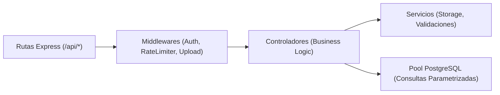

# 🎃 Concurso FMVZ — Documento 06: Diseño e Implementación del Backend Independiente

**Fecha:** 31 de Octubre de 2026  
**Tecnología:** Node.js 20 LTS + Express + TypeScript  
**Patrón de Arquitectura:** Layered Architecture (Controladores, Rutas, Servicios, Acceso a Datos)  
**Independencia de Supabase:** 100% Nativo (`node-postgres`)

---

## 1. Módulos y Controladores del Backend



### 1.1 `contestController.ts`
- `GET /api/contest/settings`: Retorna el estado público de la votación (`upcoming`, `open`, `paused`, `closed`), fechas y límites.
- `PATCH /api/admin/contest/settings`: Modifica parámetros con registro automático en `audit_logs`.

### 1.2 `participantController.ts`
- `GET /api/participants`: Lista paginada con filtrado por categoría (`student`, `worker`). **Regla de Privacidad:** Se omite `institutional_identifier` para proteger datos personales de los concursantes.
- `GET /api/participants/:number`: Retorna ficha detallada del participante.
- `POST /api/participants`: Registro de concursante. Valida límite (`registration_limit`), valida formato institucional, genera número oficial y folio `REG-FMVZ-XXXX`.
- `GET /api/participants/status/:folio`: Consulta pública de estado de aprobación.

### 1.3 `voteController.ts` (Autoridad Central de Votación)
- `POST /api/vote/identify`: Valida la estructura del número de cuenta (9 dígitos) o trabajador (6-8 dígitos) antes de pasar al paso de confirmación.
- `POST /api/vote/cast`: Ejecuta la transacción de votación en PostgreSQL.
  - Verifica que el concurso esté en estado `voting_status === 'open'`.
  - Verifica que el participante votado exista y esté en estado `approved`.
  - Normaliza identificador (`normalizeIdentifier`).
  - Ejecuta transacción `BEGIN -> INSERT INTO voters -> INSERT INTO votes -> COMMIT`.
  - Dispara evento SSE a la pantalla del auditorio.
  - Retorna `HTTP 201` con `confirmation_folio` (ej. `VOTO-2026-XXXX`).
  - En caso de reintento o voto previo, captura error SQL `23505` y retorna `HTTP 409 Conflict`.

### 1.4 `liveController.ts` (Transmisión al Auditorio en Vivo)
- `GET /api/live/stream`: Endpoint de Server-Sent Events (SSE). Mantiene las conexiones abiertas en un `Set<Response>` en memoria y envía latidos `:ping` cada 15 segundos desreferenciados (`unref()`).
- `POST /api/live/reaction`: Recibe emojis de ovación del público y los retransmite en tiempo real a la pantalla gigante del proyector.
- `GET /api/live/state`: Snapshot completo del escenario en vivo (participante en tarima, segundos restantes del temporizador, marcador).

### 1.5 `adminController.ts`
- `POST /api/admin/login`: Autentica credenciales contra la tabla `admins` usando `bcrypt.compare`. Emite JWT firmado con `JWT_SECRET`.
- `GET /api/admin/dashboard`: Métricas agregadas (votos totales, distribución por tipo de votante, participación).
- `GET /api/admin/audit`: Historial inmutable de auditoría con paginación y filtros.

---

## 2. Medidas de Seguridad y Robustez Implementadas

1. **Consultas Parametrizadas contra Inyección SQL:**  
   El 100% de las consultas a la base de datos utilizan variables parametrizadas (`$1, $2, $3`):
   ```typescript
   await client.query('SELECT * FROM voters WHERE voter_type = $1 AND normalized_identifier = $2', [type, id]);
   ```
   Queda estrictamente prohibida la concatenación directa de cadenas en SQL.

2. **Rate Limiting Multicapa:**
   - General: 100 solicitudes por minuto por IP.
   - Votaciones: 10 solicitudes por minuto por IP para mitigar ráfagas automatizadas y bots.

3. **Autenticación y Autorización por Roles:**
   - Middleware `requireAuth`: Verifica firma criptográfica del JWT y comprueba expiración.
   - Middleware `requireRole('admin')`: Restringe operaciones sensibles (cambio de estado de votación, anulación de votos) exclusivamente a usuarios con rol `admin`.

4. **Validación Exhaustiva de Entradas:**
   - Módulo `server/src/utils/validation.ts` valida nombres, tipos de votante, longitudes y formatos regex institucionales UNAM.
   - El frontend nunca es la autoridad final; todas las reglas se re-validan en el backend antes de tocar la base de datos.
