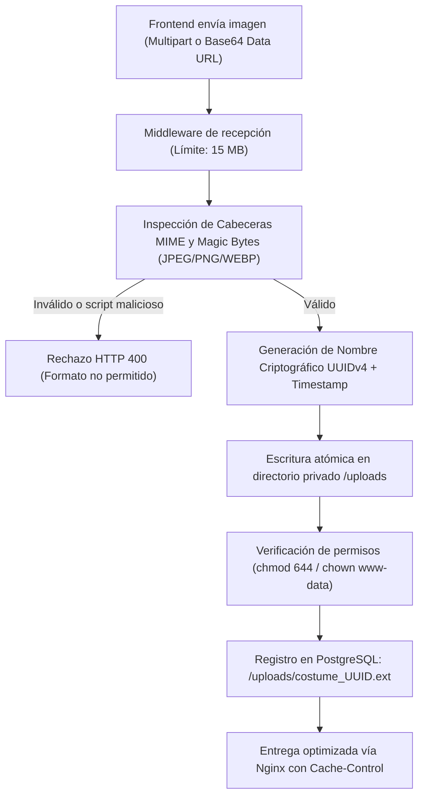

# 🎃 Concurso FMVZ — Documento 07: Diseño del Almacenamiento Local Persistente de Fotografías

**Fecha:** 31 de Octubre de 2026  
**Módulo Implementado:** `server/src/services/storageService.ts`  
**Ubicación en Servidor:** `/var/www/concurso-fmvz/server/uploads` (Nativo) / `/app/server/uploads` (Docker)  
**Objetivo:** Desacoplar las fotos de la base de datos relacional y almacenar archivos físicos en disco con alta seguridad e I/O eficiente.

---

## 1. Ciclo de Vida y Pipeline de Almacenamiento



---

## 2. Requisitos de Seguridad y Hardening Implementados

### 2.1 Validación de Tipos MIME y "Magic Bytes"
No basta con inspeccionar la extensión del archivo `.jpg` (que puede ser falsificada). `storageService.ts` examina la firma binaria de los primeros bytes del archivo:
- **JPEG:** `FF D8 FF`
- **PNG:** `89 50 4E 47 0D 0A 1A 0A`
- **WEBP:** `52 49 46 46 ... 57 45 42 50`

Cualquier archivo con extensión simulada (ej. un `.php`, `.sh` o `.js` renombrado a `.jpg`) es rechazado de inmediato.

### 2.2 Prevención de Sobrescritura y Directory Traversal
1. **Nombres Criptográficos:** Nunca se utiliza el nombre original del archivo subido por el usuario (`image.jpg`). Se asigna un identificador aleatorio único:
   ```typescript
   const safeFilename = `costume_${Date.now()}_${crypto.randomUUID().slice(0, 12)}.${ext}`;
   ```
2. **Sanitización de Rutas:** El módulo utiliza `path.resolve` y `path.basename` para impedir ataques de tipo `../../etc/passwd`.

### 2.3 Modo Dual de Operación (`STORAGE_MODE`)
En el archivo de configuración `.env`:
- `STORAGE_MODE=disk`: Guarda los archivos físicos en disco y almacena la URL relativa `/uploads/archivo.jpg` en la base de datos (Modo recomendado y por defecto para OVHcloud).
- `STORAGE_MODE=base64`: Almacena la cadena Base64 en la base de datos (Modo de compatibilidad histórica previo a la migración).
- **Retrocompatibilidad:** Si en la base de datos conviven registros antiguos con Base64 (`data:image/...`) y registros nuevos con `/uploads/...`, el frontend y el backend los renderizan sin necesidad de modificar el código de los componentes.

---

## 3. Extracción de Fotografías Existentes (`scripts/extract_photos_to_disk.mjs`)

Para migrar las imágenes actualmente almacenadas en Supabase a archivos locales en disco sin pérdida:
1. El script se conecta a la base de datos mediante `TARGET_DATABASE_URL`.
2. Lee los registros de `participants` cuya columna `photo_url` o `photo_original_key` comience con `data:image/`.
3. Decodifica el Base64 a buffer binario.
4. Escribe el archivo en `uploads/costume_contestNumber.jpg`.
5. Actualiza la columna en PostgreSQL con la ruta relativa `/uploads/costume_contestNumber.jpg`.
6. Verifica que el archivo exista en disco y que su tamaño sea mayor a 0 bytes antes de confirmar la actualización.

---

## 4. Política de Respaldos de Fotografías

- **Script:** `scripts/backup_uploads.sh`
- **Comportamiento:** Empaqueta y comprime con `tar -czf` la carpeta completa `/uploads` en `/var/backups/concurso-fmvz/uploads_backup_YYYYMMDD_HHMMSS.tar.gz`.
- **Rotación:** Retiene automáticamente los últimos 14 días y elimina respaldos más antiguos.
- **Restauración:** `scripts/restore_uploads.sh` restaura y valida los permisos en segundos.
