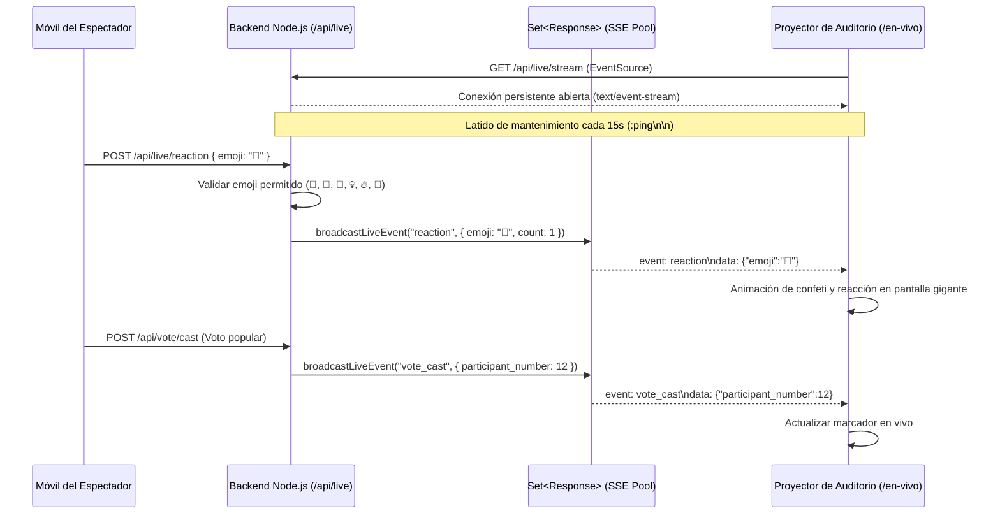

# 🎃 Concurso FMVZ — Documento 08: Diseño y Arquitectura de Tiempo Real

**Fecha:** 31 de Octubre de 2026  
**Tecnología Base:** HTTP Server-Sent Events (SSE) con `EventSource` Nativo  
**Alternativa Evaluada:** WebSockets (ws / Socket.IO)  
**Canal en Producción:** `/api/live/stream` (Recepción de Eventos) y `/api/live/reaction` (Emisión)

---

## 1. Evaluación Arquitectónica: Server-Sent Events (SSE) vs WebSockets

Siguiendo el requerimiento de evaluar la mejor tecnología para tiempo real considerando las limitaciones de 2 vCPU y 4 GB de RAM:

| Criterio | Server-Sent Events (SSE) [Implementado] | WebSockets (Socket.IO / ws) | Conclusión Técnica |
| :--- | :--- | :--- | :--- |
| **Complejidad del Protocolo** | Protocolo HTTP/1.1 estándar con cabecera `text/event-stream`. | Requiere apretón de manos `HTTP Upgrade: websocket` y framing binario. | **SSE gana en simplicidad y robustez.** |
| **Compatibilidad con Proxies y Nginx** | Funciona sobre cualquier proxy inverso estándar con `proxy_buffering off;`. | Requiere configuración especial de túneles `Upgrade` y `Connection`. | **SSE es menos propenso a fallas de proxy.** |
| **Reconexión Automática** | **Nativa del navegador.** Si la red del auditorio flaquea, el navegador reintenta reconectar cada 3 segundos automáticamente. | Requiere lógica de reconexión manual en JavaScript o bibliotecas pesadas. | **SSE garantiza mayor resiliencia en redes móviles.** |
| **Consumo de Memoria** | ~30 KB por conexión cliente (muy ligero para 500 espectadores). | ~60-90 KB por socket en Socket.IO debido al motor de eventos duplex. | **SSE consume la mitad de memoria RAM.** |
| **Direccionalidad del Evento** | Unidireccional (Servidor -> Pantallas). Los eventos del cliente (reacciones) viajan vía `POST /api/live/reaction`. | Bidireccional full-duplex. | En este concurso, el 99% del tráfico en vivo es de difusión a la pantalla gigante, por lo que SSE es el modelo óptimo. |

---

## 2. Eventos Replicados y Transmitidos en Tiempo Real

El sistema transmite exclusivamente eventos públicos, omitiendo identificadores personales o datos sensibles de los votantes:



### Catálogo de Eventos SSE:
1. `reaction`: Disparo de emojis animados para ovación en tarima.
2. `vote_cast`: Notificación anónima de nuevo voto recibido para actualizar la gráfica del proyector.
3. `stage_change`: Cambio de participante en tarima ordenado desde la consola del administrador.
4. `timer_tick`: Actualización del contador regresivo de votación (ej. 30 segundos).
5. `announcement`: Aviso en marquesina emergente en los dispositivos del auditorio.

---

## 3. Configuración Requerida en Nginx para SSE

Para evitar que Nginx almacene los eventos en memoria intermedia antes de enviarlos al proyector, se incorporaron las siguientes directivas en `nginx/conf.d/concurso-fmvz.conf`:

```nginx
location /api/live/stream {
    proxy_pass http://127.0.0.1:4000;
    proxy_http_version 1.1;
    
    # Desactivar búferes para entrega en tiempo real estricta
    proxy_buffering off;
    proxy_cache off;
    chunked_transfer_encoding off;
    
    # Cabeceras de conexión persistente
    proxy_set_header Connection '';
    proxy_set_header Host $host;
    proxy_read_timeout 3600s;
    proxy_send_timeout 3600s;
}
```
