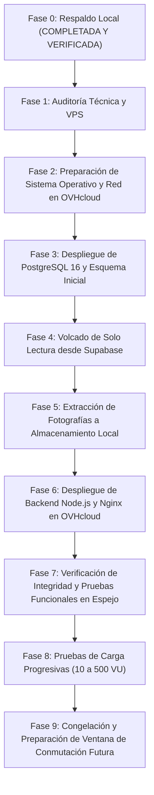

# 🎃 Concurso FMVZ — Documento 12: Plan Maestro de Migración hacia Infraestructura Espejo en OVHcloud

**Fecha:** 31 de Octubre de 2026  
**Dirección de la Migración Inicial:** `SUPABASE → OVHCLOUD` (Solo lectura en Supabase; cero escrituras)  
**Objetivo:** Construir una réplica funcional idéntica en OVHcloud mientras producción continúa operando en Render sin perturbación alguna.

---

## 1. Fases Cronológicas del Plan Maestro



---

## 2. Protocolo de Extracción de Datos de Supabase (Solo Lectura)

1. **Garantía de No Invasión:**
   - No se ejecutan `ALTER TABLE`, `UPDATE` ni `DELETE` sobre la base de datos de Supabase.
   - La extracción se realiza mediante una conexión estándar de lectura `pg_dump`:
     ```bash
     pg_dump "$SUPABASE_READONLY_URL" \
       --no-owner \
       --no-privileges \
       --data-only \
       --exclude-table=schema_migrations \
       > /tmp/supabase_production_data.sql
     ```
2. **Carga en PostgreSQL de OVHcloud:**
   - La base de datos local en OVHcloud se inicializa con `server/src/db/migrations/001_initial_schema.sql`.
   - Se inyectan los datos:
     ```bash
     psql "$OVH_LOCAL_DATABASE_URL" < /tmp/supabase_production_data.sql
     ```
3. **Sincronización de Secuencias:**
   - Se ajustan los correlativos `SELECT setval('participants_id_seq', MAX(id)) FROM participants;` para evitar colisiones en futuros registros.

---

## 3. Matriz de Validación de Datos Post-Migración

| Entidad | Criterio de Aceptación | Método de Comprobación |
| :--- | :--- | :--- |
| **`contest_settings`** | Exactamente 1 registro idéntico con límites y fechas. | `SELECT count(*) FROM contest_settings;` |
| **`admins`** | 2 registros de administradores con contraseñas encriptadas con `bcrypt`. | `SELECT email, role FROM admins;` |
| **`participants`** | 100% de los concursantes migrados con sus folios y números correlativos. | `SELECT count(*), max(contest_number) FROM participants;` |
| **`voters`** | Identidades normalizadas intactas. | `SELECT count(*) FROM voters;` |
| **`votes`** | Cero votos huérfanos (`voter_id` y `participant_id` válidos). | Query anti-join ejecutada en `verify_db_integrity.sh`. |
| **Fotografías** | Cada participante cuenta con su archivo físico en `/uploads` verificado en tamaño. | `ls -la /var/www/concurso-fmvz/server/uploads | wc -l` |
