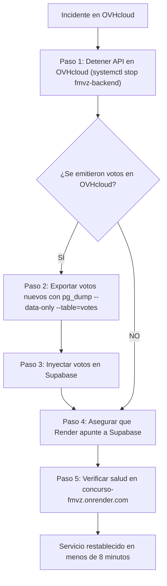

# 🎃 Concurso FMVZ — Documento 13: Plan de Reversión y Contingencia Inmediata (Rollback)

**Fecha:** 31 de Octubre de 2026  
**Tiempo Objetivo de Reversión (RTO):** Menor a 8 minutos  
**Pérdida Tolerada de Datos (RPO):** 0 minutos (Cero votos perdidos)

---

## 1. Criterios de Disparo de la Reversión (Rollback Triggers)

Se abortará cualquier intento de conmutación si ocurre alguno de los siguientes eventos en los primeros 30 minutos de prueba en el espejo:
1. Fallo en la recepción de votos (`/api/vote/cast`) con errores HTTP 500 no recuperables en 3 minutos.
2. Inconsistencia o divergencia en el conteo total de votos entre los sistemas.
3. Latencias p95 superiores a 2,500 ms bajo concurrencia moderada.
4. Caída o desbordamiento de memoria del servicio PostgreSQL en el VPS.
5. Imposibilidad de entregar Server-Sent Events a la pantalla del auditorio.

---

## 2. Procedimiento de Reversión Paso a Paso



### Comandos de Ejecución:

1. **Detener el tráfico en OVHcloud:**
   ```bash
   sudo systemctl stop fmvz-backend
   ```
2. **Extraer votos diferenciales (si se emitieron en el espejo):**
   ```bash
   pg_dump -U fmvz_admin -d fmvz_halloween --data-only --table=votes --table=voters > /tmp/votos_diferenciales.sql
   psql "$SUPABASE_URL" < /tmp/votos_diferenciales.sql
   ```
3. **Verificar Render:**
   - La aplicación en Render no se modifica hasta la aprobación final; por lo tanto, continúa en línea y lista para absorber el 100% de los usuarios.
