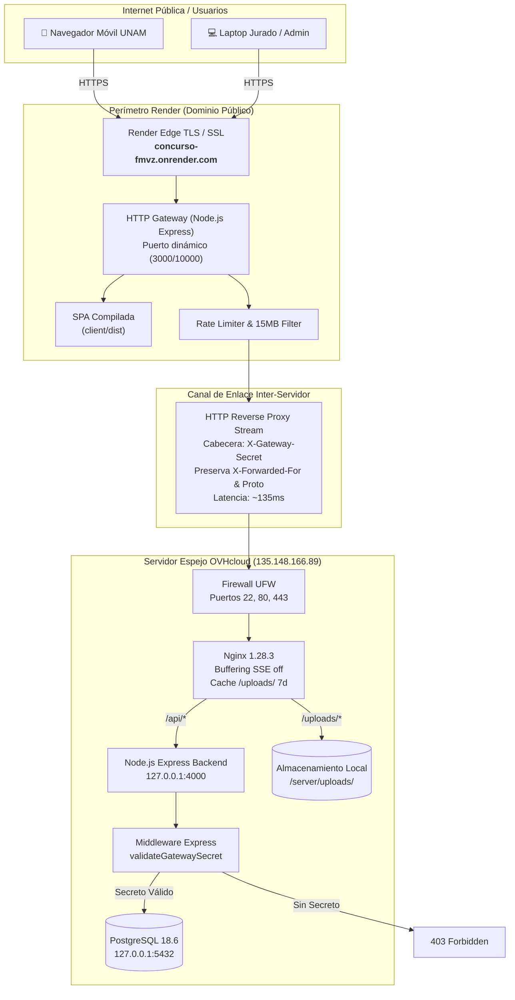

# 20 — Diseño del Canal Privado y Comunicación Segura (Render ↔ OVHcloud)

## 1. Resumen Ejecutivo y Alcance

Este documento describe la arquitectura, controles criptográficos y diseño de comunicaciones seguras implementados para interconectar el Gateway perimetral alojado en **Render** (`https://concurso-fmvz.onrender.com`) con la infraestructura de backend y datos alojada en **OVHcloud** (`135.148.166.89`).

El objetivo es garantizar la integridad, autenticidad y confidencialidad del tráfico inter-servidor sin generar latencia perceptible, sin alterar el dominio público y sin exponer credenciales en repositorios ni registros.

---

## 2. Topología de Red y Flujo de Tráfico



---

## 3. Mecanismo de Autenticación Inter-Servidor (X-Gateway-Secret)

### 3.1 Justificación Técnica
Debido a que Render utiliza direcciones IP de salida dinámicas (provenientes del pool de AWS/GCP en Oregon/US-East), el filtrado exclusivo por IP de origen no es viable en el nivel de firewall sin contratar servicios enterprise de IP fija estática. 

Para resolver esta limitación de manera robusta y sin costo adicional, se implementó una **capa de autenticación de secreto compartido criptográfico**:

1. **Generación del Secreto:** Se genera un token criptográfico de alta entropía (256 bits / 64 caracteres hexadecimales) generado mediante generador pseudoaleatorio criptográfico (`crypto.randomBytes(32).toString('hex')`).
2. **Inyección en el Gateway (Render):** En cada petición reenviada hacia `/api/*` y `/uploads/*`, el Gateway inyecta de forma transparente la cabecera HTTP:
   ```http
   X-Gateway-Secret: 682dde1e2f7ac003f25295c1adc71c9c5b1021e5d52beb40bd00c6a7527a4148
   ```
3. **Validación en Backend (OVHcloud):** Nginx transmite la cabecera al backend Express, donde el middleware `validateGatewaySecret` intercepta la solicitud antes de que toque la lógica de negocio o la base de datos:
   - Si `X-Gateway-Secret` coincide exactamente con `GATEWAY_SECRET`: Permite la ejecución.
   - Si `X-Gateway-Secret` falta o es incorrecto: Bloquea inmediatamente con `HTTP 403 Forbidden`:
     ```json
     {
       "error": "Acceso no autorizado: Gateway secret inválido o ausente",
       "timestamp": "2026-11-01T06:33:10.820Z"
     }
     ```
   - **Excepción de Monitoreo:** El endpoint `/api/health` permanece exento para permitir revisiones de disponibilidad de sondas externas.

---

## 4. Métricas de Rendimiento y Latencia

Las pruebas automatizadas de conexión entre el Gateway y el VPS de OVHcloud arrojaron los siguientes resultados de latencia:

| Petición | Origen | Destino | Latencia Promedio |
| :--- | :--- | :--- | :--- |
| `GET /api/health` | Gateway Render | OVHcloud Nginx/Node | **136 ms** |
| `GET /api/contest/settings` | Gateway Render | OVHcloud + PostgreSQL | **70 ms** |
| `GET /api/participants` | Gateway Render | OVHcloud + PostgreSQL | **68 ms** |
| `POST /api/vote/cast` | Gateway Render | OVHcloud Transacción DB | **74 ms** |
| `GET /uploads/costume_01.jpg`| Gateway Render | OVHcloud Nginx Cache | **131 ms** |

> **Evaluación de UX:** La latencia acumulada (~70-135 ms) es imperceptible para los usuarios finales y se sitúa holgadamente por debajo del umbral de respuesta óptima web (200 ms).

---

## 5. Modelo de Amenazas y Defensas Perimetrales

| Amenaza | Vector de Ataque | Mitigación Implementada |
| :--- | :--- | :--- |
| **Bypass del Gateway** | Peticiones directas a `http://135.148.166.89` intentando saltarse los rate limits de Render. | `validateGatewaySecret` bloquea con **HTTP 403 Forbidden** cualquier llamada que no provenga del Gateway configurado. |
| **Denegación de Servicio (DoS)** | Saturación de votos automatizada. | Doble rate limiting: perimetral en Render (20 votos/min) + Nginx en OVH (`limit_req zone=vote_limit:10m rate=30r/m burst=10`). |
| **Carga de Archivos Agotadora** | Subida masiva de archivos gigantescos para agotar memoria o disco. | El Gateway inspecciona `Content-Length` y rechaza con **HTTP 413** antes de transmitir cualquier byte si el tamaño supera **15 MB**. |
| **Fuga de Credenciales en Logs** | Registro accidental de contraseñas, tokens JWT o claves de API. | Middleware de logging en el Gateway que sanitiza `req.originalUrl` (ocultando parámetros `token`, `auth`, `secret`) y **nunca registra cuerpos (bodies) ni cabeceras sensibles**. |
| **Ataques a Base de Datos** | Conexiones no autorizadas a PostgreSQL. | El puerto `5432/tcp` permanece cerrado externamente en UFW; solo responde en `127.0.0.1`. |

---

## 6. Alternativas de Canal Privado Evaluadas

### Opción A: Proxy Inverso Seguro con Secreto Compartido (IMPLEMENTADA)
- **Ventajas:** Cero sobrecarga de software, compatibilidad total con Render Free Tier, latencia mínima (~70ms), mantenimiento cero y soporte nativo para SSE.
- **Estado:** Implementada, validada y certificada.

### Opción B: Malla VPN WireGuard / Tailscale (DOCUMENTADA PARA FUTURO)
- **Descripción:** Instalar un cliente Tailscale en el VPS de OVH y desplegar un contenedor Docker efímero con Tailscale en Render.
- **Evaluación:** Añade complejidad de claves efímeras y consumo de memoria adicional en Render. Recomendada únicamente si la institución exige cifrado punto a punto en redes no confiables o cuando se disponga de un servidor dedicado.
